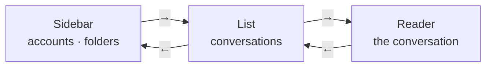
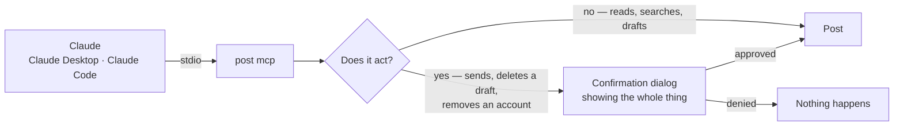

# Post


Post is Gmail as a native window on Linux, a command in the terminal, and a set
of tools for Claude. Each connected account is its own Post — nothing merges
several accounts' mail into one list.

### Accounts, folders, search

- **The sidebar** lists your accounts — each with an initial in its own colour,
  its name and its inbox's unread count — then the folders of the account on
  screen, as Gmail has them: Inbox, Starred, Important, Sent, Drafts, Spam,
  Trash, then your own labels by name, nested ones under their parent. Each
  folder shows how many of its conversations are unread; Drafts shows how many
  drafts there are. The counts are kept up to date in the background.
- **Search** with `/`: a Gmail search in the account you are in. Results are a
  list of their own, and Back from a message returns to them.
- **All / Unread** narrows any folder or search to what is unread.
- **Rows** show an unread dot, the sender, the time, the subject and the start
  of the newest message. Opening a conversation marks it read.

### Reading

- **Conversations**, oldest to newest, each message a line — the open one with
  its sender, the address it was sent to, the account it came to, and the date.
- **HTML mail** is laid out and painted by [Blitz](https://github.com/DioxusLabs/blitz),
  a native HTML/CSS engine, in the theme's colours. Pictures load; links open
  in your browser; selection and `Ctrl+C` work. No browser engine is embedded.
- **Attachments** open, save, or save as.
- **The reader's bar**: Reply, Forward, Delete, and Mark unread.

### Writing

- **Every draft is a Gmail draft.** What you type is saved to the account's
  Drafts a moment after you pause, and when you leave the screen — so it is in
  Gmail on your phone and the web too. Send sends that draft; Discard deletes
  it. Pressing Reply without typing leaves nothing behind.
- **Addresses are chips.** An address becomes a chip on space, comma, Enter or
  leaving the field; its ✕ takes it off, and Backspace in an empty field takes
  the last one back. Cc and Bcc wait behind a toggle. Send refuses while a field
  holds text that is not an address.
- **From** is a picker of your accounts for a new email; a reply or a forward
  goes from the account the message came to.
- **Links** are found and highlighted as you type. The body is plain text —
  nothing else is formatting.
- **Attachments** sit above the body as cards: name, size, ✕.
- **Reply** answers everyone on the conversation, with the message quoted
  under yours. **Forward** carries the original's attachments and the message
  itself under a *Forwarded message* header, and may go without a note.
- **Drafts** from Gmail open straight into the compose screen, attachments and
  all.

### Settings

From the gear at the bottom left: your accounts, then the one you pick beside
them. Give an account a name — it shows everywhere its address did. *Remove*
asks first, then takes the account off this computer: its sign-in, and the mail
Post keeps for it. Gmail itself is untouched. *Add account* opens Google's own
consent screen in your browser; Post never sees your password. Below them,
*Claude* switches Post's tools for Claude on and off.

### A window that fits its width

| Window width | Columns |
|---|---|
| over 1200 | sidebar 232 · list 400 · reader |
| 1000 – 1200 | sidebar 232 · list 340 · reader |
| 760 – 1000 | rail of icons 60 · list 340 · reader |
| under 760 | rail · one column: the screen you are on |

On a wide window a click opens a conversation beside its list; on a narrow one
the same click opens it full width, with a back arrow. Resizing keeps what is
open.

### Every screen is an address

Every screen has a route, so the command line, a `mailto:` link, a second
launch and your assistant can all open Post exactly there — and a second launch
hands its route to the window that is already open instead of opening another.

| Route | Screen |
|---|---|
| `/:account/:folder` | A folder — a Gmail label id: `INBOX`, `SENT`, `Label_12` |
| `/:account/search/:query` | A search in that account |
| `/:account/:folder/:id` | A conversation |
| `/:account/:folder/:id/reply` · `…/forward` | A reply · a forward |
| `/:account/new?to=&cc=&bcc=&subject=&body=&attach=` | A new email, filled in |
| `/:account/drafts/:draft` | A Gmail draft |
| `/settings` · `/settings/:account` | Settings · one account |

**Back goes up one level** — from a conversation to its folder, from a reply to
its conversation — and every screen comes back exactly as you left it: the
same rows, the same selection, the same scroll, without fetching anything
again. Picking another message beside its list replaces the open one, so Back
still goes to the list.

### Keyboard

Post is built to be driven from the keyboard. **Left and Right move between the
columns; Up and Down walk the one you are in; Enter opens what the keyboard is
on.** Moving opens nothing: what is open stays open. The keyboard's place is a
thin outline, shown only in the column the keyboard is in; what is open is
filled.



| Key | Sidebar | List | Reader |
|---|---|---|---|
| `↑` `↓` | accounts and folders | rows | scroll the message |
| `→` | to the list | to the reader — or, with nothing open, open the row | — |
| `←` | — | to the sidebar | to the list — or Back, when no list is beside it |
| `Enter` | open it, then on into its list | open the row | open or close the message |
| `PageUp` `PageDown` | | a screenful of rows | a screenful of the message |
| `End` | the last stop | the last row, and the page after | |

| Anywhere | |
|---|---|
| `R` · `F` | Reply · Forward |
| `Delete` · `Ctrl+U` | Move to the trash · Mark unread |
| `/` | Search this account |
| `Ctrl+N` · `Ctrl+Enter` | New email · Send |
| `Esc` · `Backspace` | Back |
| `Home` | Settings |
| `Ctrl+R` | Refresh what is on screen |
| `Ctrl+C` | Copy the selection |
| `Ctrl+K` · `Ctrl+/` · `F1` | Every action and its key: the palette |
| `Ctrl+W` | Close the window |

**The palette has every action there is, found by typing.** `Ctrl+K` opens it,
from a text field too, and so does the keyboard button beside the gear, whose
tooltip names the key. It lists what does something where you are — Send and
Attach while writing, Reply while reading, All or Unread on a list — each with
the key it is on, then what is on screen to act on: who it is from, the files
going with it, the open message's attachments, and the folders, accounts and
settings to go to. `↑` `↓` walk it, `Enter` runs one, `Esc` closes it.

Every binding can be changed: Post reads `$POST_KEYMAP`, `./keymap.toml` or
`~/.config/post/keymap.toml`, over its built-in [`keymap.toml`](crates/post-ui/keymap.toml).

## Claude

When Post first starts, it asks whether Claude may use it. Yes adds Post to
Claude Desktop and Claude Code — whichever are installed — and installs the
**post** skill, which teaches them how to use the tools below. The switch in
Settings changes the answer: off takes the entry and the skill out again.



### Tools

| Tool | |
|---|---|
| `post_accounts` | The connected accounts and the names they go by — where to start |
| `post_labels` | An account's folders, with unread counts |
| `post_list` | A page of the inbox, a folder (`label`), or a Gmail search (`query`) |
| `post_read` · `post_thread` | One message · a whole conversation |
| `post_draft` · `post_new` · `post_forward` | Write a reply, a new email, a forward — as a Gmail draft; nothing is sent |
| `post_draft_read` · `post_draft_delete` | Read a draft · delete one for good |
| `post_send` | Send a draft |
| `post_mark` · `post_delete` · `post_attachment` | Read or unread · to the trash · save an attachment |
| `post_rename` · `post_remove` · `post_add_account` | Name an account · take one off this computer · connect one |
| `post_show` | Put the Post window on screen, at any route |

### Asking first

- **Sending mail, deleting a draft and removing an account always ask**, in a
  dialog that shows the whole message — every address, the subject, the
  attachments and every word of the body. Sending and removing can never be
  allowed for good.
- Reading, searching, drafting and marking are free.
- What an email says is a stranger's text: the tools hand it over as data,
  never as instructions to follow.

## Command line

| Command | |
|---|---|
| `post` | Post, at your first inbox |
| `post list <email>` · `read <email> <id>` · `reply <email> <id>` | Post, at that screen |
| `post open <route>` | Post, at any route |
| `post <verb> …` | Any mail verb from a terminal — `accounts`, `labels`, `list`, `read`, `thread`, `draft`, `new`, `forward`, `send`, `mark`, `delete`, `attachment`, `rename`, `remove`, … |
| `post mcp` | The MCP server Claude launches |

Post also handles `mailto:` links: [`packaging/post.desktop`](packaging/post.desktop)
registers it as your mail app.

## Where things live

| | |
|---|---|
| `~/.config/post/` | Your accounts and their Google sign-ins, the Claude choice, the tools allowed for good, and an optional `keymap.toml` |
| `~/.local/share/post/` | What Post keeps to be fast — the inbox's last page, messages already read, mail bodies — all of it rebuildable from Gmail |
| Your download folder | Attachments you save |

## Building

```sh
cargo build --release
```

The binary is `target/release/post`. The Google OAuth client is built into it,
from git-ignored `config/oauth.json` (`{"google":{"client_id":…,"client_secret":…}}`)
or from `POST_GOOGLE_CLIENT_ID` and `POST_GOOGLE_CLIENT_SECRET`.

| Crate | |
|---|---|
| [`post`](crates/post) | The mail library — Gmail, OAuth, caches, Gmail drafts — and its verbs, the same ones the window, the terminal and Claude use |
| [`post-ui`](crates/post-ui) | The window, drawn with [omarchy-kit](https://github.com/edimoldovan/omarchy-kit) |
| [`post-app`](crates/post-app) | The `post` binary: its roles, the MCP server and the confirmation dialog |
